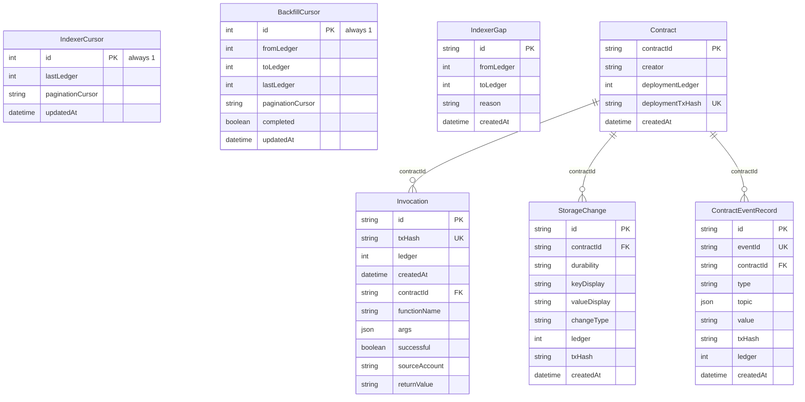

# Contributing to Prism

Thank you for helping build better Stellar tooling!

## How to Contribute

1. Fork the repository
2. Create a feature branch: `git checkout -b feat/your-feature`
3. Commit your changes: `git commit -m "feat: your feature"`
4. Push and open a Pull Request

## Areas to Contribute

- New explorer views (contract state, event logs, storage)
- Indexer improvements in `indexer/src/`
- UI components and design
- RPC integration and data parsing
- Soroban smart contracts in `contracts/`
- Tests and documentation

## Project Structure

| Directory     | Description                          |
| ------------- | ------------------------------------ |
| `frontend/`   | Next.js explorer UI                  |
| `indexer/`    | Event indexer (TypeScript + Prisma)  |
| `contracts/`  | Soroban smart contracts (Rust)       |

## Commands

### Frontend (`frontend/`)

```bash
cd frontend
npm install
npm run dev        # Start dev server
npm run lint       # Run linter
npm run test       # Run tests
npm run build      # Production build
```

### Indexer (`indexer/`)

```bash
cd indexer
npm install
npm run dev             # Start indexer in watch mode
npm run test            # Run tests
npm run prisma:generate # Generate Prisma client
npm run prisma:migrate  # Run database migrations
npm run build           # Compile TypeScript
npm run start           # Run compiled output
```

#### Changing the Prisma schema

`indexer/prisma/schema.prisma` and the committed migrations in
`indexer/prisma/migrations/` must stay in sync; CI fails otherwise. After
editing the schema, generate a migration and commit it with your change:

```bash
cd indexer
# Requires DATABASE_URL to point at a dev Postgres database.
npx prisma migrate dev --name describe_your_change
```

This creates `prisma/migrations/<timestamp>_describe_your_change/migration.sql`.
Review the generated SQL, commit it alongside `schema.prisma`, and run
`npx prisma generate` so the client types match.

To check locally that nothing is missing before pushing:

```bash
cd indexer
npx prisma migrate diff \
  --from-migrations prisma/migrations \
  --to-schema-datamodel prisma/schema.prisma \
  --shadow-database-url "file:./shadow.db" \
  --exit-code
```

An exit code of `0` means the schema and migrations agree; `2` means a
migration is missing.

### Contracts (`contracts/`)

```bash
cd contracts
cargo build         # Build contracts
cargo test          # Run contract tests
```

## Rust / Soroban Contract Contributions

The contracts in `contracts/` are Rust smart contracts targeting Soroban.
The pinned toolchain in `contracts/rust-toolchain.toml` provides the Wasm
target and Rust tooling used by CI.

Run these commands from `contracts/`:

```bash
cargo build --workspace
cargo build --workspace --target wasm32v1-none --release
cargo test --workspace
cargo fmt --all -- --check
cargo clippy --workspace --all-targets -- -D warnings
```

Before opening a PR, ensure formatting and clippy pass and all contract tests
are green.

### Adding a New Contract

1. Create a crate under `contracts/` and add it to the workspace `members` in
   `contracts/Cargo.toml`.
2. Set `crate-type = ["cdylib", "rlib"]` and use the workspace
   `soroban-sdk` dependency.
3. Implement the contract with `#[contract]` and `#[contractimpl]`, and add
   tests using `soroban_sdk::Env`.
4. Commit any generated test snapshots with the contract changes.
5. Update the frontend or indexer types and documentation if they consume the
   contract's storage or events.

### Soroban / Stellar Documentation

- [Soroban smart contracts](https://developers.stellar.org/docs/smart-contracts)
- [Soroban Rust SDK](https://docs.rs/soroban-sdk)
- [Stellar developer docs](https://developers.stellar.org/docs)
- [Stellar SDKs](https://developers.stellar.org/docs/tools/sdks)

## Indexer Database Schema

The indexer persists to PostgreSQL via Prisma. The schema lives in
`indexer/prisma/schema.prisma`; migrations are in `indexer/prisma/migrations/`.
After changing the schema, run `npm run prisma:migrate` and
`npm run prisma:generate` in `indexer/`.

### ER Diagram



### Tables

#### `IndexerCursor`

Singleton row (`id` is always `1`) tracking how far the live indexer has
processed. Forward-only: on first run it is seeded to the current latest ledger
(or just before `INDEXER_START_LEDGER`), never backfilled from history.

| Column             | Type       | Description                                              |
| ------------------ | ---------- | -------------------------------------------------------- |
| `id`               | `Int` PK   | Always `1`; enforces a single cursor row.                |
| `lastLedger`       | `Int`      | Highest ledger fully processed by the live indexer.      |
| `paginationCursor` | `String?`  | Opaque RPC pagination token for resuming mid-page.       |
| `updatedAt`        | `DateTime` | Auto-updated on every write.                             |

#### `BackfillCursor`

Singleton row (`id` is always `1`) tracking progress of a historical backfill
run over a fixed ledger range.

| Column             | Type       | Description                                              |
| ------------------ | ---------- | -------------------------------------------------------- |
| `id`               | `Int` PK   | Always `1`; enforces a single cursor row.                |
| `fromLedger`       | `Int`      | First ledger of the backfill range (inclusive).          |
| `toLedger`         | `Int`      | Last ledger of the backfill range (inclusive).           |
| `lastLedger`       | `Int`      | Highest ledger processed so far in the range.            |
| `paginationCursor` | `String?`  | Opaque RPC pagination token for resuming mid-page.       |
| `completed`        | `Boolean`  | `true` once the whole range has been processed.          |
| `updatedAt`        | `DateTime` | Auto-updated on every write.                             |

#### `IndexerGap`

A ledger range the live indexer skipped without indexing, and why. Gaps apply
to every contract, so they are not keyed by contract.

| Column      | Type       | Description                                              |
| ----------- | ---------- | -------------------------------------------------------- |
| `id`        | `String` PK| `cuid()` identifier.                                     |
| `fromLedger`| `Int`      | First skipped ledger (inclusive). Indexed.               |
| `toLedger`  | `Int`      | Last skipped ledger (inclusive).                         |
| `reason`    | `String`   | Why the range was skipped (e.g. RPC error, retention).   |
| `createdAt` | `DateTime` | When the gap was recorded.                               |

#### `Contract`

One row per contract deployment observed by the indexer.

| Column             | Type       | Description                                              |
| ------------------ | ---------- | -------------------------------------------------------- |
| `contractId`       | `String` PK| Stellar contract address (`C...`).                       |
| `creator`          | `String`   | Account that deployed the contract. Indexed.             |
| `deploymentLedger` | `Int`      | Ledger in which the deployment transaction landed.       |
| `deploymentTxHash` | `String` UK| Hash of the deployment transaction (unique).             |
| `createdAt`        | `DateTime` | Contract creation timestamp.                             |

#### `Invocation`

One row per contract function invocation (successful or failed).

| Column          | Type       | Description                                              |
| --------------- | ---------- | -------------------------------------------------------- |
| `id`            | `String` PK| `cuid()` identifier.                                     |
| `txHash`        | `String` UK| Transaction hash (unique).                               |
| `ledger`        | `Int`      | Ledger containing the invocation.                        |
| `createdAt`     | `DateTime` | Ledger close time of the invocation.                     |
| `contractId`    | `String`   | Contract invoked; references `Contract.contractId`. Indexed with `ledger`. |
| `functionName`  | `String`   | Invoked function name.                                   |
| `args`          | `Json`     | Decoded invocation arguments.                            |
| `successful`    | `Boolean`  | Whether the invocation succeeded.                        |
| `sourceAccount` | `String`   | Account that submitted the transaction.                  |
| `returnValue`   | `String?`  | Decoded return value; `null` when unavailable or failed. |

#### `StorageChange`

Append-only log of observed contract storage changes (not just the latest
value). The "current value" for a key is its most recent non-`removed` row.
This is what makes full key enumeration possible for contracts touched since
the indexer started.

| Column         | Type       | Description                                                          |
| -------------- | ---------- | -------------------------------------------------------------------- |
| `id`           | `String` PK| `cuid()` identifier.                                                 |
| `contractId`   | `String`   | Contract whose storage changed; references `Contract.contractId`.    |
| `durability`   | `String`   | `persistent`, `temporary`, or `instance`.                            |
| `keyDisplay`   | `String`   | Human-readable decoded key (`__instance__` for the instance entry).  |
| `valueDisplay` | `String?`  | Human-readable decoded value; `null` when `changeType` is `removed`. |
| `changeType`   | `String`   | `created`, `updated`, `removed`, or `state`.                         |
| `ledger`       | `Int`      | Ledger in which the change occurred.                                 |
| `txHash`       | `String`   | Transaction that caused the change.                                  |
| `createdAt`    | `DateTime` | Ledger close time of the change.                                     |

Unique on `(txHash, contractId, keyDisplay, durability, changeType)` to keep
re-processing idempotent; indexed on `(contractId, keyDisplay, durability,
ledger)` and `(contractId, ledger)`.

#### `ContractEventRecord`

One row per contract event emitted by a transaction.

| Column       | Type       | Description                                              |
| ------------ | ---------- | -------------------------------------------------------- |
| `id`         | `String` PK| `cuid()` identifier.                                     |
| `eventId`    | `String` UK| Unique event identifier from the RPC.                    |
| `contractId` | `String`   | Emitting contract; references `Contract.contractId`. Indexed with `ledger`. |
| `type`       | `String`   | Event type (e.g. `contract`, `system`, `diagnostic`).     |
| `topic`      | `Json`     | Decoded event topics.                                    |
| `value`      | `String`   | Decoded event body.                                      |
| `txHash`     | `String`   | Transaction that emitted the event.                      |
| `ledger`     | `Int`      | Ledger containing the event.                             |
| `createdAt`  | `DateTime` | Ledger close time of the event.                          |

### Relationships

- `Contract` → `Invocation`, `StorageChange`, `ContractEventRecord`: one-to-many
  on `contractId`. These are logical references (no Prisma `@relation`), so
  rows can be written before the `Contract` row exists; queries join on
  `contractId` and tolerate missing parents.
- `IndexerCursor`, `BackfillCursor`, and `IndexerGap` are standalone: they
  track indexer progress and skipped ranges globally, not per contract.
- `Invocation.txHash` and `StorageChange.txHash` / `ContractEventRecord.txHash`
  correlate rows from the same transaction but are not foreign keys.

## Code Style

Run the linter before submitting:

```bash
cd frontend && npm run lint
```

For Rust contracts, run `cargo fmt --all -- --check` and
`cargo clippy --workspace --all-targets -- -D warnings` from `contracts/`.

## Changelog

Every pull request that adds a feature, fixes a bug, or makes a breaking change
**must** include a changelog entry in `CHANGELOG.md` under the `[Unreleased]`
section.

Format:

```markdown
### Added / Changed / Fixed / Removed / Security

- Short description of the user-visible change (PR #NNN)
```

If your change is purely internal (CI config, test-only, dev-tooling, typo fix)
you may skip the changelog entry.

## Release process

Releases are cut from `main` by a maintainer:

1. Update `CHANGELOG.md` — rename `[Unreleased]` to `[X.Y.Z] — YYYY-MM`, add a
   new empty `[Unreleased]` section, and update the comparison links at the bottom.
2. Commit with the message `chore: release vX.Y.Z`.
3. Create a git tag `vX.Y.Z` and push it.
4. GitHub Actions publishes the Docker images and creates a GitHub Release with
   the changelog section as the release notes body.

## Issues

Check open issues for tasks labeled `good first issue` or `help wanted`.

## Further reading

- [docs/onboarding.md](docs/onboarding.md) — a first-PR walkthrough for the
  frontend, indexer, and contracts.
- [ENVIRONMENT.md](ENVIRONMENT.md) — every environment variable, with defaults.
- [GLOSSARY.md](GLOSSARY.md) — Soroban and Stellar terms in plain language.
- [docs/api-reference.md](docs/api-reference.md) — the JSON API and its
  rate-limiting/back-off model.
- [docs/troubleshooting.md](docs/troubleshooting.md) — common self-hosting
  issues and fixes.
- [adr/](adr/README.md) — architecture decision records.
- [indexer/README.md](indexer/README.md#event-processing-flow) — the indexer's
  poll → decode → persist → notify flow (sequence diagram) and database schema
  (ER diagram).

## Load testing

A k6 load test for the `GET /api/contract/[id]/events` endpoint lives in `tests/load/events-load-test.js`.
It sends 100 concurrent requests and asserts p99 latency is below 500 ms with no 5xx responses.

### Install k6

```bash
curl -fsSL https://get.k6.sh | bash
```

### Run the load test

Start the frontend, then run the load test against it:

```bash
cd frontend
npm install
npm run build
npm run start        # serves on http://localhost:3000
```

In another terminal:

```bash
CONTRACT_ID=<contract-id> k6 run tests/load/events-load-test.js
```

Override the target origin with `BASE_URL` (default `http://localhost:3000`):

```bash
BASE_URL=https://explorer.example.com CONTRACT_ID=<contract-id> k6 run tests/load/events-load-test.js
```

Results are streamed to stdout and, in CI, uploaded as workflow artifacts.

> **Note on rate limiting.** Every `/api/*` route is rate-limited (30 req/min
> per client, see the README). A single load generator therefore reaches the
> limit quickly and most requests return `429` — which is still a non-5xx,
> fast response, so the `p99 < 500 ms` and `no 5xx` thresholds hold. To load
> the backend itself, run the frontend with `TRUST_PROXY=1` behind a proxy that
> sets a distinct `X-Forwarded-For` per virtual user, or raise the limit in
> `frontend/src/lib/rate-limit.ts` for the duration of the test.
